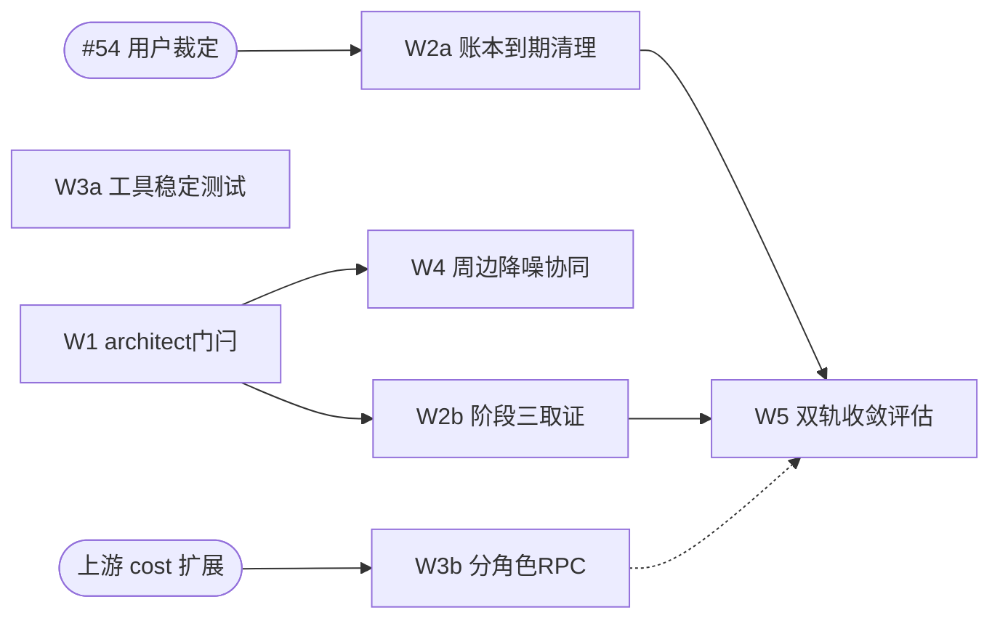

# 阶段三编排收敛与持续打磨规格说明

日期：2026-11-28
基线：`main` `56b6338`（含阶段三角色落地提交 `6a3834f`），并对照 `docs/orchestration-evolution.md` 与 `docs/research-planner-split-prior-art-2026-11-28.md`
状态：**执行中**（2026-11-28：W1、W3a 与 W4 本仓派工表约定已完成；W2a/W2b/W3b/W4 跨仓部分/W5 仍按票据阻塞）

## 1. 文档元数据与授权边界

### 1.1 范围与授权声明

本文规划 `docs/orchestration-evolution.md` 中「阶段三（规划抽离：最强模型只规划，Root 只编排）」落地后的收敛与打磨工作。全文严格区分三类内容：**仓库已核查事实**、**基于证据的推断**、**待执行工作包计划**。

边界与限制如下：

1. 本文最初作为规划交付时仅新增 `.scratch/stage3-orchestration-polish/spec.md`；2026-11-28 经用户要求执行后，已按第 5 节创建 `.scratch/stage3-orchestration-polish/issues/01..07-*.md`，并完成 W1、W3a 与 W4 本仓派工表约定。
2. 本文是规划与拆票依据，**不自动授权**越出既有范围的付费模型对照实验、生产环境安装或 `/reload`、跨仓库（如 `pi-subagents`、`pi-todo`、宿主 `codemode`）代码提交，也不自动授权删除尚待用户在 issue `#54` 最终裁定的 §0 台账机制。
3. 后续任何涉及行为变更的票据执行时，均须遵循 `AGENTS.md` 测试门禁（先写测试并核验因缺少目标行为产生的红灯，再写实现并跑通发布测试；临时目录一律置于仓库外 `/project/tmp`，严禁写入 `/tmp`）。

### 1.2 核心准入准则（沿用删减计划 §0）

严格沿用 `docs/pi-planner-only-subtraction-plan.md` 第 0 节判据：历史实测表明编排开销主要来自 `Root 轮数 × Root 上下文`（小任务 P3 走委派耗费 815k 至 847k token，约为直接执行 54.5k 的 15 倍；0.3 基线中 Root 占总成本 60% 至 78%，每任务 11 至 18 轮 Root，每轮重读 30k 至 50k 缓存 token）。

因此，本文每个工作包及后续拆出的每张票据都必须正面回答：**它让真实大任务少了几轮 Root（或显著压低了每轮重读的 Root 上下文），还是防住了哪个真实发生过、代价很大的事故？** 答不出该问题的机制一律不立项；纯契约守卫或可观测性补齐必须标明「仅工程 / 防回归」，且不得增加每轮重读的 Root 系统提示长度。

---

## 2. 现状诊断：阶段三之后的五个真实缺口

### 2.1 缺口一：角色提示词与离线派工规范断层

- **仓库事实**：
  1. 提交 `6a3834f` 新增了只读打包角色 `agents/architect.md`（frontmatter 为 `tools: read, grep, find, ls, contact_supervisor`、`acceptanceRole: read-only`、`thinking: high`、`defaultContext: fresh`、`systemPromptMode: replace`、`inheritProjectContext: true`、`inheritSkills: false`），并将 `index.ts:30` 的 `NATIVE_PROMPT` 路由目标从 `oracle` 切为 `architect`；`index.test.mjs:205-208` 的 `usesNativeArchitect` 断言强制 `NATIVE_PROMPT` 必须包含 `architect` 且不得出现 `oracle`。
  2. 离线完整判断表 `.scratch/native-root-dispatch/spec.md`（基线仍停留在 `908c624`，2026-11-20）第 1、2、4、5、6、7 节全文仍将撰写方案契约的角色写成 `oracle`，未与 `CHANGELOG.md:7` 及 `docs/pi-planner-only-subtraction-plan.md:49`（本包 `architect` 承接方案契约起草，内置 `oracle` 保留作决策一致性顾问）对齐。
  3. `#60` 写入 `.scratch/native-root-dispatch/spec.md` 第 2、5、7 节的四项关键纪律尚未同步到 `agents/architect.md`：(a) 意图清晰（CLEAR）时只梳理不可逆、破坏性或产生花费的业主决策，意图模糊（UNCLEAR）时直接采用并声明默认假设；(b) 实施步骤采用 `- [ ]` 可勾选复选框以便跨会话续跑；(c) 每步建议角色严格限定为 `worker`、`scout`、`reviewer`；(d) 交回前执行五项遗漏自检（隐藏意图、歧义、范围膨胀、缺失验收、未处理边界）。
  4. 提问通道表述不一致：`.scratch/native-root-dispatch/spec.md:84-88` 按无中途通道假设写成「梳理出业主决策交回 Root，由 Root 向用户提问」，而 `agents/architect.md:15` 已配置 `contact_supervisor`，要求事实缺失影响选型时先用 `contact_supervisor`（`reason: need_decision`）向 Root 提一个聚焦问题并等待答复，无法获得答复时才返回 `blocked`。
- **影响推断**：由于 `agents/architect.md` 采用 `systemPromptMode: replace` 且在 `fresh` 上下文运行，只要 Root 在手写任务包时漏抄 `.scratch/native-root-dispatch/spec.md` 第 7 节的细节，`architect` 就看不到 CLEAR/UNCLEAR 过滤、复选框步骤格式和五项自检，离线规范无法稳定兑现。

### 2.2 缺口二：规划与验收收敛门闩偏弱

- **仓库事实**：
  1. `docs/diagnosis-om36-native-convergence-2026-10-29.md`（第 1、3、4.1 节）记录：历史 Native 长会话 `01a1855b-03db-7434-9609-567b54578fc5` 持续约 13 小时 27 分钟，同一后端待办三次完成又三次重开（`M:327/386`、`M:510/550`、`M:793/837`），四版矩阵审查累计 708 回合（184、188、181、155）。根因是迭代前未冻结样本集与失败率阈值，把「真实模型矩阵中无剩余语义反例」当作无边界完成条件，叠加 Root 目标漂移（`M:933`）；直到用户 `M:898` 下达收敛边界后约 18 分钟才形成交接。
  2. `agents/architect.md:19-24` 现行 6 节模板顺序为「4. 按依赖排序的实施步骤 -> 5. 验证命令与成功标准」，实施拆分在前、验证定义在后。对照 `docs/research-planner-split-prior-art-2026-11-28.md` 第 2.2 节与第 4 节第 2 条（Factory Missions 先冻结可测试行为断言的「验证合约」再拆功能步骤），后置编写验证标准容易顺着既定实现缩水或写出不可证伪的空泛条件。
  3. `.scratch/native-root-dispatch/spec.md` 第 6 至 7 节规定了高风险方案实施前由 `reviewer`「一次一过」，但尚未明确写入 `docs/research-planner-split-prior-art-2026-11-28.md` 第 1.3 节与第 4 节第 1 条总结的「偏批准（bias toward approval）」硬判据（仅因查证属实的阻塞项驳回，推测性问题或非阻塞备注直接放行）。
- **影响推断**：缺少「验证断言先于步骤冻结」和「审方案偏批准」，规划复核与交付验收仍易陷入围绕风格偏好或开放式指标的多轮往返。

### 2.3 缺口三：§0 台账待裁定、常驻提示词预算紧绷与分角色成本盲区

- **仓库事实**：
  1. 常驻提示词逼近测试上限：`index.test.mjs:196` 限制 Lite `plannerPrompt` 小于 `1,500` 字符（当前实测非 strict 为 `1,492` 字符、strict 为 `1,483` 字符）；`index.test.mjs:200-204` 以 `NATIVE_PROMPT_CHAR_CAP = 1_200`（开区间 `< 1_200`，带等长故障注入检查）限制每轮注入的 `NATIVE_PROMPT`。注：`#55`/`#56`（`ef87a05`）落盘时记录长度为 `1,125` 字符（`.scratch/native-root-dispatch/spec.md:3`、`docs/pi-planner-only-subtraction-plan.md:46,48`、`index.test.mjs:199` 注释及 `docs/research-planner-split-prior-art-2026-11-28.md:127` 仍保留该历史数字），其后经 `8622b9a`（增加局部例外排除项与首份方案禁自写，增至 `1,152` 字符）与 `6a3834f`（5 处 `oracle` 替换为 `architect`）两轮提交，`index.ts:30` 当前实测长度已达 **1,167** 字符，距 `< 1_200` 上限仅余 **32** 字符。
  2. `2026-12-15` 到期的 4 行暂定项已有增量取证但待裁定（issue `#54`，`docs/pi-planner-only-subtraction-plan.md` 第 24、38、39、42、43 行）：2026-11-27 重跑 `scan2.py`（本机留存为 `/home/tcuni-claw/pi/s0-evidence-20261127/scan2-baseline.py` 与 `scan_incr.py`）扫描 3,217 个 jsonl / 978 个根会话，新窗口（`2026-11-16T03:23:52Z` 之后）130 个根会话中，`84e3519`（`handoff` `brief` 扩展字段）33 次交接仅 10 次出现状态词、23 次未出现，0 次挡住新会话重走废路（建议撤回）；`f363b30`（`Native 任务粒度`）0 次触发 `INCOMPLETE`，落地 28 天前提未再现（建议撤回）；`8db3e6c`（局部任务例外）11 个会话有 1 至 3 次编辑且零子代理、3 个会话不少于 8 次编辑且零子代理，用法真实但缺成本净省测量（建议保留-仅工程）；`e44bdef`（锁/并发前置独立审查）56 次提及独立 reviewer，但 0 次真在审锁或并发，新窗口 9 次 `race` 命中全为 `target-id-trace` 误报（建议保留-仅工程）。
  3. 阶段三末尾 4 行新机制（`docs/pi-planner-only-subtraction-plan.md` 第 46 至 49 行：`07f776f/#55` 按角色分流、`ef87a05/#56` 再规划与摩擦交回、`#60` 访谈分工与可续用方案、`architect` agent）全部标为「暂定-待证 / 待用户」，尚无上线后实测数据。
  4. Native 用量缺少分角色拆解：`index.ts:520-551` 的 `refreshNativeCost` 通过 `subagents:rpc:v1:request`（`method: "cost"`）仅读取 `reply.data.childTotal` 总量下界（`index.ts:300-304, 475`），不像 Lite 具备 `PlannerSession.roleStats`（`index.ts:80-95, 158, 182-202, 441-475`），无法直接观察 `architect`、`scout`、`worker`、`reviewer` 各自的调用次数与花费下界。
- **影响推断**：`NATIVE_PROMPT` 仅剩 32 字符空间，任何新增细节都不能再往 Root 常驻提示里堆；同时若不完成 `#54` 到期清理和阶段三取证，§0 台账将失去淘汰约束力。

### 2.4 缺口四：Root 上下文膨胀与周边缓存、通知、状态摩擦

- **仓库事实**（见 `docs/native-week-2026-11-18.md` 第 5 至 65 行）：
  1. 交接频繁：一周 112 个有记录的 Native Root 会话（8,151 条助手记录）中，56 个调用 `subagent`，**60 个调用 `handoff`**（共 77 次调用，57 次获调度）。
  2. 工具集变动击穿缓存：`<5` 分钟的 3,459 对连续请求中，20 对发生 `cacheRead=0` 完全未命中，其中 **16 对**紧随移除 `bg_wait` 工具声明之后；`137k` 案例（会话后缀 `2145a69e`）因中途移除 `bg_wait` 导致 `136,838` 输入 token 缓存归零，单轮估算价差 `$1.231542`。本机用户级扩展 `~/.pi/agent/extensions/slim-tools.ts` 虽已改为仅在 Lite 过滤（见该文第 34、40 行），但本仓测试尚未锁死 Native 同会话多轮工具声明不变性。
  3. `codemode` 超长返回：487 份返回中有 **168 份超过 20,000 字符**（波及 40 个会话），其中 42 份带宿主外层截断标记的返回合计 `1,690,283` 字符（波及 25 个会话）。
  4. `pi-subagents` 通知重复：348 条完成通知中 28 条含 workflow receipt，其中 **26 条（12 个会话）**在 `Return:` 与 `Child outputs:` 间存在至少 50 字符的规范化重复文本。
  5. `pi-todo` 并行摩擦：103 次调用中 **20 次失败**（20 个会话），全因「最多一项 `in_progress`」（19 次显式传入多项进行中，15 次紧接下一条助手记录重提交；已向 `/public/scripts/pi-todo` 派单，尚未完成验收，见第 64 行）。
- **影响推断**：中等模型做 Root 后，单 token 单价下降，但大体积工具回显、重复完成通知、全量 diff 阅读与前缀缓存失守仍会推高会话总输入量与交接次数。

### 2.5 缺口五：Lite 与 Native 双轨维护及真实流量倒挂

- **仓库事实**：
  1. 流量高度单边化：`docs/pi-planner-only-subtraction-plan.md:24` 显示 2026-11-27 增量窗口 130 个根会话中 **127 个为 Native（97.7%）**。
  2. Lite 专属角色零运行：同表第 31 行记录，本包专为 Lite 验证拆出的 `agents/planner-validator.md`（`fa03a63` / `#36`）落地后 **0 次运行**。
  3. 工程投入与流量倒挂：新会话无偏好时的代码默认值仍为 `lite`（`index.ts:54`、`README.md:9`），且仓库核心代码量集中在 Lite 独有的 `delegate.ts`、cwd 读写锁、`git.ts`、`PI_PLANNER_ONLY_STRICT=1` 工具层禁写拦截（`index.ts:35, 688-696`）和 `roleStats` 上；而占 97.7% 流量的 Native 在 `tool_call` 上直接放行（`index.ts:689`），完全依赖提示词维持「局部任务例外」（对照 `docs/research-planner-split-prior-art-2026-11-28.md` 第 1.3、1.4、2.1、3 节中 Cursor、omo、Roo 对编排者不写产品代码的硬边界）。
- **影响推断**：继续对 Lite 与 Native 平均分配特性开发会摊薄维护精力；需评估 Native 是否需要可选轻量工具层护栏，并明确 Lite 何时转入维护冻结。

---

## 3. 明确不做的方向（Non-Goals 与护栏）

1. **不恢复插件侧任务账本与自动续跑架构**：不恢复 0.2 至 0.8 时期的持久化任务状态机或证据新鲜度审计（`docs/pi-planner-only-subtraction-plan.md` §2.1），不引入 `.omo/boulder.json` 进度表，不解析结构化子代理报告合同，不做空闲轮自动续跑或每条用户消息强制先规划（`CHANGELOG.md:11`）。
2. **不重开 worker 多档廉价模型路由**：`docs/worker-tiers-evidence-2026-10-06.md`（第 16 行及第 6.10 节，第 346 至 354 行）盘点 194 次真实有效 worker 委派证明，简单执行任务（S 类）约占 16% 至 34%，全部改用廉价模型仅省总花费约 2%（低于预设 5% 门槛）。保持单档 worker，除非未来中等模型 Root 显著压低分母后，经同口径复算证明价差收益稳定跨过 5% 线。
3. **不上调常驻提示词字符上限**：保持 `index.test.mjs:200` 的 `NATIVE_PROMPT_CHAR_CAP = 1_200` 与 `index.test.mjs:196` 的 Lite `plannerPrompt` `1,500` 字符上限不变（issue `#25`）。角色细则一律下沉至按需读取的 agent 定义或离线判断表。
4. **不放宽 `architect` 只读契约与白名单测试守卫**：`agents/architect.md` 维持 `tools: read, grep, find, ls, contact_supervisor` 与 `acceptanceRole: read-only`，不开放 `bash`、`edit`、`write`；`contract.test.mjs:155-169, 188-197` 对 `architect` 工具白名单及追加 `bash` 的故障注入检查不得删改或弱化。
5. **不静默修改既有测试断言**：凡因清理到期机制或调整提示词需要改动的既有断言（如 `index.test.mjs:190` 的 `expectedNativePrompt`、`index.test.mjs:113-116` 的 `briefDescription` 匹配），必须在对应实施票据中逐条单列「获授权修改断言清单」；新增任何运行时或契约守卫必须附带可触发失败的故障注入测试。

---

## 4. 五个工作包（W1 至 W5）的具体设计、改动落点与验收标准

### 4.1 W1：规则下沉至 `architect` 与收敛门闩收紧（零 Root 常驻 token 成本，最先执行）

- **§0 准入依据**：直接针对 `om36` 无边界验收三次重开事故（`docs/diagnosis-om36-native-convergence-2026-10-29.md` §4.1）与方案复核多轮空转，同时弥合 `6a3834f` 后 `agents/architect.md` 与 `.scratch/native-root-dispatch/spec.md` 的规范断层。所有新增文本均落在 `defaultContext: fresh`、按需启动的 `agents/architect.md` 与离线判断表中，**Root 每轮常驻提示词增量为 0**。
- **改动落点一：同步 `.scratch/native-root-dispatch/spec.md` 角色口径与提问边界**
  1. 将文首及第 1、2、4、5、6、7 节中「撰写与修订可引用方案契约」的目标角色统一由 `oracle` 改为 `architect`；明确说明 `pi-subagents` 内置 `oracle` 仅保留作按需决策一致性顾问，不承担方案契约起草。同步将第 3 行记载的 `NATIVE_PROMPT` 长度从历史值 `1,125` 更新为基线 `56b6338` 实测值 `1,167`（测试上限仍为 `1,200`）。
  2. 对齐第 5、7 节与 `agents/architect.md:15` 的提问通道：`architect` 为只读子代理，不直接与最终用户对话，也不直接写工作区文件；仓库源码、配置和既有文档能查清的事实必须自行只读核实，禁止经 `contact_supervisor` 反问 Root；仅当仓库无法回答的业主决策（不可逆、破坏性、产生花费）或关键业务口径缺失并影响选型时，通过 `contact_supervisor`（`reason: need_decision`）向 Root 提一次聚焦问题（Root 可自行裁决或转问用户）；仅当无法通过该通道取得答复且缺项实质阻断选型时，才返回 `blocked` 并列出缺项及选型影响。方案定稿后的落盘与执行勾选仍由 Root 负责。
- **改动落点二：修订 `agents/architect.md` 正文与 6 节方案模板**
  1. **Frontmatter 保持原样不变**（`tools: read, grep, find, ls, contact_supervisor`、`acceptanceRole: read-only`、`thinking: high`、`defaultContext: fresh`、`systemPromptMode: replace`、`inheritProjectContext: true`、`inheritSkills: false`）。
  2. **吸收探索上限与 CLEAR / UNCLEAR 业主决策过滤**：必读参考材料宜控制在 3 份以内，先读适用的 `AGENTS.md`、任务包指定材料与相关源码；意图清晰（CLEAR，目标结果已定、仅剩业主偏好）时，只就仓库答不了的不可逆、破坏性或产生花费的业主决策调用 `contact_supervisor`（`reason: need_decision`）并附原因，不连问实现细节；意图模糊（UNCLEAR，目标结果本身未定）时，采用一套稳妥默认假设并在第 2 节显式声明，交 Root 与用户审视或否决。
  3. **重排并收紧 6 节方案模板（验证断言前置冻结于步骤拆分之前）**，拟修订模板片段如下：

```markdown
方案固定使用以下 6 节（先冻结可证伪的验证标准，再拆分实施步骤）：

1. 背景与边界：说明问题背景、本次改动范围（Scope），以及明确不做、不阻断本次交付的事项（Non-Goals）。
2. 已决定事项：列出已锁定的选型、已否决方案及否决原因；若原始意图存在模糊处（UNCLEAR），在此显式声明所采用的默认假设供 Root 与用户审视。
3. 接口、数据与异常契约：用真实文件路径、模块名与符号定义输入输出、状态不变量及异常边界，不写易失效的精确行号。
4. 验证命令与可证伪完成断言（先于实施步骤冻结）：列出确定性检查命令、预期退出码或可观察产物；若涉及模型输出或非确定性行为，必须指定固定样本集与失败率阈值，不得以「无剩余反例」等开放式表述作为完成标准。
5. 按依赖排序的可勾选实施步骤：每步以 `- [ ] 步骤 N：...` 格式书写，注明该步对应的验证命令（引用第 4 节）及建议执行角色（仅限 `worker`、`scout`、`reviewer`，不写模型名或外部类别），供 Root 落盘并在验收后勾选。
6. 风险与重新规划条件：列出具体、可观察的停工交回信号（如前置接口与代码实况不符、按第 4 节验证连续失败两次、或修复需引入计划外持久化与新协议），不写「遇问题再规划」等空泛措辞。
```

  4. **加入交回前五项遗漏自检**：`architect` 输出最终方案前，逐项自检隐藏意图、术语或口径歧义、范围膨胀、缺失可执行验收断言、未处理异常或并发边界，将结论直接补入上述 6 节正文，不额外派生规划复核角色。
- **改动落点三：在 `.scratch/native-root-dispatch/spec.md` 第 6 至 7 节写入审方案「偏批准」约定**
  1. 第 6 节明确：实施前的高风险方案复核遵循「偏批准」原则，一次一过；`reviewer` **仅因经代码或契约查证属实的阻塞项**（破坏既有公共契约、越出授权范围、关键异常或权限失守、第 4 节完成断言不可验证）才可否决并附具体依据；若仅剩非阻塞改进建议或推测性风险，即判为通过（附备注），由 Root 酌情吸收后进入实施。若某轮复核既未提出新的可查证阻塞证据，也未给出通过结论，Root 立即停止复核循环并交用户裁定。
  2. 第 7 节审方案 `reviewer` 任务包模板同步写入上述「偏批准、仅查证属实阻塞项可驳回、仅剩备注即通过、一次一过」提示语。
- **W1 验收标准**：
  1. 运行 `TMPDIR=/project/tmp npm run test:release`（若本机全局 `pi-subagents` 缺少 `@earendil-works/pi-ai` peer，则按 `AGENTS.md` 运行 `TMPDIR=/project/tmp npm run test:release:isolated`）全部通过。
  2. 契约不变量：`index.ts` 未改动，`NATIVE_PROMPT.length` 仍为 `1,167` 字符（`< 1_200`）；`contract.test.mjs` 对 `architect` 的工具白名单与 `bash` 故障注入断言全部通过；文档路径引用与无破折号检查通过。

### 4.2 W2：§0 台账到期清理（`2026-12-15`）与阶段三离线取证

#### W2a：4 行 `2026-12-15` 到期暂定机制的按裁定清理

- **前置条件**：**必须在用户在 issue `#54` 填入「最终处置」之后方可实施**；用户裁定前不得提前删改运行时提示词或工具 schema。
- **§0 准入依据**：清理连续两个扫描窗口无实证收益的条款，回收每轮重读的 `NATIVE_PROMPT` 预算与 `handoff` 工具描述冗余。
- **四项机制的具体处置方案、字符释放量与联动清单**（基于基线 `56b6338` 实测）：
  1. `84e3519`（`handoff` `brief` 字段扩展；账本第 38 行建议：**撤回**）：
     - 代码改动：在 `index.ts:618` 的 `handoff` 工具 `brief` 参数描述中，移除 `approaches ruled out and why, `、`how it was verified (command -> result; mark anything not verified as unverified), ` 与 `known pitfalls, ` 三个子句；完整保留 `53499d7`、`be287c3`、`c335408` 已验证有效的授权来源分离条款与必填 `progress`。`NATIVE_PROMPT` 释放 `0` 字符（减少的是暴露 `handoff` 工具时的 schema token）。
     - 获授权修改断言清单：移除 `index.test.mjs:113-116` 四条正则断言（`/approaches ruled out and why/`、`/command -> result/`、`/unverified/`、`/known pitfalls/`），保留 `index.test.mjs:112, 117-123` 及 `handoff.test.mjs` 全部既有断言（包括 `handoff.test.mjs:300` 对 wrapper 连续性文本的断言）。
     - 同步文档：`CHANGELOG.md`、`docs/pi-planner-only-subtraction-plan.md:38`「最终处置」列（`CONTEXT.md:26` 的连续性表述归属授权边界，核对后保持不变）。
  2. `f363b30`（`Native 任务粒度` 零触发条款；账本第 42 行建议：**撤回**）：
     - 代码改动：定位 `index.ts:30` 中由 `f363b30` 引入的两句（第 1 句「每次委派只交付一项可单独验收的成果……互不依赖且可分别验收的成果分开委派。」计 `74` 字符；第 2 句「子代理请求拆分或只交回部分结果时……缩范围时沿用原模型，仍失败再换模型。」计 `74` 字符）。鉴于 `.scratch/om36-review-lessons/findings.md:9` 曾记录过一次部分结果缩范围续用案例，严格按用户在 `#54` 的最终裁定粒度执行：若整段撤回则释放 **148** 字符（`NATIVE_PROMPT` 降至 `1,019` 字符），若仅撤回零触发子句则释放 **74** 字符（降至 `1,093` 字符）。
     - 获授权修改断言清单：同步更新 `index.test.mjs:190` 的 `expectedNativePrompt` 字符串常量（该常量在 `index.test.mjs:918, 1058, 1062` 被引用），保留 `withinNativeCap`、`usesNativeArchitect` 及其故障注入断言不变。
     - 同步文档：`README.md:118`、`README.zh-CN.md:99`、`CHANGELOG.md`、`docs/pi-planner-only-subtraction-plan.md:42`「最终处置」列。
  3. `8db3e6c`（Native 局部任务例外；账本第 39 行建议：**保留-仅工程**）：
     - 分支方案：若用户裁定「保留」，运行时代码与测试零改动，仅更新 `docs/pi-planner-only-subtraction-plan.md:39`「最终处置」列，并在 W5 中继续观察；若用户按「到期无轮次/成本量化证据则撤回」裁定「撤回」，则移除 `index.ts:30` 的局部例外句（`79` 字符）并调整前后衔接词，净释放约 **80** 字符，同步更新 `index.test.mjs:190` `expectedNativePrompt`、`.scratch/native-root-dispatch/spec.md` 第 1 节、`README.md:118`、`README.zh-CN.md:99`、`CHANGELOG.md` 与账本第 39 行。
  4. `e44bdef`（同状态修复合并与锁/并发前置独立审查；账本第 43 行建议：**保留-仅工程**）：
     - 分支方案：若用户裁定「保留」，运行时代码与测试零改动，仅更新 `docs/pi-planner-only-subtraction-plan.md:43`；若用户裁定「撤回并发审查子句或整段」，对应 `index.ts:30` 中同状态修复合并句（`48` 字符）与并发前置审查及导出句（`142` 字符，其中并发审查 `87` 字符、范围与导出说明 `55` 字符），按裁定范围释放 **87 至 190** 字符，同步更新 `index.test.mjs:190` `expectedNativePrompt`、`README.md:118`、`README.zh-CN.md:99`、`CHANGELOG.md` 与账本第 43 行。
- **W2a 验收标准**：先仅修改获授权测试断言并验证红灯输出，再修改 `index.ts` 与文档并跑通 `TMPDIR=/project/tmp npm run test:release`（或 `test:release:isolated`）；确认未触碰任何未获 `#54` 授权的断言。

#### W2b：阶段三 4 行新机制的只读离线取证

- **§0 准入依据**：用真实会话日志检验阶段三（`07f776f/#55`、`ef87a05/#56`、`#60`、`architect` agent）是否真正降低了 Root 轮数与总成本占比，为 `docs/pi-planner-only-subtraction-plan.md` 第 46 至 49 行提供裁定依据。
- **具体设计与指标口径**：
  1. 在本机私有证据目录（如 `/home/tcuni-claw/pi/s0-evidence-stage3-<日期>/` 或 `/project/tmp/` 子目录，禁止写入 `/tmp`，原始输出与含客户路径的脚本不入库），基于 `/home/tcuni-claw/pi/s0-evidence-20261127/scan2-baseline.py` 与 `scan_incr.py` 扩展阶段三扫描脚本，保持按 `parentId` 继承 `planner-only-mode` 的同口径切分，以 `6a3834f` 上线时间点划分阶段三观测窗口。
  2. 统计并对照以下 6 项指标：(a) `architect` 触发率及单会话派发次数分布（核查是否遵守「默认短 Approach 直派 worker，仅需契约时派 `architect`」）；(b) 跨 `handoff` 方案续用率（已落盘方案的跨会话链中，新 Root 按剩余 `- [ ]` 续跑而未重复派 `architect` 的比例）；(c) 高风险方案 `reviewer` 复核轮数（验证是否达成「一次一过」）；(d) `worker` 三类执行摩擦纯文本交回 Root 的命中频次与后续处置分布；(e) 单会话及同目标交接链的 Root 轮数；(f) Root 与各子代理的 token 及按计价表折算的成本占比（对比贵模型单干 Root 的历史基线）。
  3. 将脱敏汇总写入 `docs/pi-planner-only-subtraction-plan.md` §0.1 第 46 至 49 行「证据指针」列及 `CHANGELOG.md`，报用户在 `#54` 裁定。
- **W2b 验收标准**：全程只读扫描本地 jsonl，零模型 API 调用；入仓文本不含任何客户路径或业务代码片段，分母、时间窗与排除规则完整可复算。

### 4.3 W3：Native 工具声明稳定性守卫与分角色用量观测

#### W3a：同会话多轮工具声明稳定性回归测试（本仓独立可做）

- **§0 准入依据**：防止本扩展在同会话多轮运行中增删或重排工具声明，避免再次诱发 `137k` 输入缓存归零事故（`docs/native-week-2026-11-18.md:5-22`）。
- **具体设计与改动落点**：
  1. 在 `index.test.mjs` 增加覆盖 `native`、`lite`、`off` 三种模式的同会话多轮（至少连续 3 轮）`before_agent_start` 稳定性断言：验证 `session_start` 完成初始绑定后，在不执行模式切换命令的前提下，后续每轮 `pi.getActiveTools()` 元素与顺序恒等，且第 2 轮起 `pi.setActiveTools` 调用次数为 `0`；同时验证当宿主每轮传入相同顺序的 `systemPromptOptions.selectedTools`（包括 `handoff` 原本位于中间位置的输入顺序）时，每轮输出的 `selectedTools` 顺序恒定一致（若发现 `index.ts:677-678` 因过滤 `PLUGIN_TOOLS` 后再 `push("handoff")` 改变宿主原有 `handoff` 相对位置，做最小保序修正以保证首轮与后续轮完全幂等）。
  2. 在 `host-runtime.test.mjs` 增加基于真实 Pi 1.7.0 宿主的 Native 模式连续两轮离线流式回归测试，断言两轮请求间工具定义列表无增删、无重排。
  3. 补充故障注入测试：模拟中间轮次外部或内部注入工具顺序漂移，确认测试守卫能捕获差异并失败。
- **W3a 验收标准**：若有代码修正则严格执行先红灯后绿灯；`TMPDIR=/project/tmp npm run test:release`（或 `test:release:isolated`）全部通过。

#### W3b：协同 `pi-subagents` 的可选分角色用量观测扩展

- **§0 准入依据**：补齐 Native 模式下 `architect`、`worker`、`scout`、`reviewer` 的会话内调用数与成本下界可见性，无需每次离线扫盘即可监控阶段三分工是否跑偏。
- **具体设计与协议边界**：
  1. **向后兼容的 RPC 扩展形状（需先与上游 `pi-subagents` 对齐）**：保持 `subagents:rpc:v1:request`（`{ version: 1, requestId, method: "cost" }`）及回复中 `data.version: 1`、`data.childTotal` 的字段与语义完全不变；提议上游在 `reply.data` 中新增可选字段 `byAgent?: Record<string, { runs: number; completed?: number; failed?: number; input: number; output: number; cacheRead: number; cacheWrite: number; cost: number }>`。本仓不直接读取 `pi-subagents` 私有内部模块或未公开的收据文件格式。
  2. **本仓消费与展示设计（`index.ts`）**：
     - `refreshNativeCost`（`index.ts:535-547`）仍以 `childTotal` 合法性作为主开关；当可选的 `byAgent` 存在且各项为非负有限数时存入 `PlannerSession` 内存态，若上游为未带 `byAgent` 的旧版本或 `byAgent` 局部格式非法，则仅忽略分角色明细，保留 `childTotal` 正常显示。
     - **底部状态栏维持单行紧凑不变**：`nativeTotals`（`index.ts:300-304`）继续仅渲染 `root ... · child ≥... · ctx ...`，不塞入分角色文本（保持与 `index.test.mjs:1274-1276` 相同的简洁度）。
     - 仅在 `/planner-only status` 命令通知（`notifyStatus`，`index.ts:461-476`）中，当 `byAgent` 非空时追加分角色调用数、token 与 `≥$cost` 下界汇总；无该字段时输出与现行完全一致。
- **W3b 验收标准**：上游支持落定后，在 `index.test.mjs`（含旧版无 `byAgent` 回退、脏字段忽略、状态栏不膨胀、跨会话重置与旧请求丢弃故障注入）及 `contract.test.mjs` 补齐测试并通过发布门禁，同步更新 `README.md`、`README.zh-CN.md` 与 `CONTEXT.md`。

### 4.4 W4：压降 Root 上下文增速的周边协同与验收习惯

- **§0 准入依据**：针对 60/112 个 Native 会话触发 `handoff` 的高上下文增速（`docs/native-week-2026-11-18.md:20`），按职责归属在源头消减无效上下文注入，避免在 `pi-planner-only` 内堆砌越界补丁。
- **跨仓协同边界（不在本仓重复造轮子）**：
  1. **`pi-todo` 并行运行态验收（归属 `/public/scripts/pi-todo`）**：跟进 `docs/native-week-2026-11-18.md:50, 64` 已派单改造，用历史 20 份多 `in_progress` 失败请求的状态形状做回放验收，确保并行子任务期间不再因单焦点限制报错重提，单任务与 `blocked` 语义不退化。
  2. **`pi-subagents` workflow 完成通知去重（归属 `pi-subagents`）**：依据 `docs/native-week-2026-11-18.md:52` 的 26/28 重叠样本，向 `pi-subagents` 上游（其 `src/runs/background/notify.js`）提交去重建议：同一通知内 `Return:` 已包含的段落不在 `Child outputs:` 重复展开，同时严格保留各子项终态、独有结论、失败原因、产物路径及 supervisor 请求，不吞唤醒事件。
  3. **宿主 `codemode` 批量长输出摘要化（归属 Pi 宿主层）**：依据 `docs/native-week-2026-11-18.md:51` 的 168/487 超 `20,000` 字符样本，向宿主提议批量读/执行默认输出短摘要（子调用状态、首个错误、完整输出路径，支持按需展开），以同批样本离线核验首屏字符降幅、额外读取轮数与错误保留率。
- **本仓侧实验性验收约定（写入 `.scratch/native-root-dispatch/spec.md` 试用，零代码改动）**：
  - 在不违背「Root 按真实 diff 与检查输出验收，不信子代理自述」的前提下，于 `.scratch/native-root-dispatch/spec.md` 第 3、7 节区分改动规模：小范围改动由 Root 直接读取完整 diff 与测试输出；跨多文件或大体积改动（例如 `git diff --stat` 显示范围较大或超过 `32 KiB`）时，Root 先看 `git diff --stat` 与测试退出码，再委派挂载了 `reviewer-git.ts`（`git_review` 只读分页工具，通过 `scripts/check-reviewer-config.mjs` 校验）的独立 `reviewer` 通读全部分页并返回带文件与符号定位的审查报告，Root 仅定点展开可疑切片与关键接口核实。
- **W4 验收标准**：跨仓改动在各自仓库闭环；本仓分层 diff 验收约定试用满一个自然窗口后，结合 W2b 脚本核对同规模任务的 `handoff` 触发间隔与漏检情况，证实有益则保留，否则从派工表撤回。

### 4.5 W5：中长期架构收敛评估（Lite 与 Native 的终局关系）

- **§0 准入依据**：解决 97.7% 真实会话跑在 Native 而大部分工程代码与工具层护栏留在 Lite（`planner-validator` 0 次运行）的长期维护错配（`docs/pi-planner-only-subtraction-plan.md:24, 31`）。
- **步骤一：将「Native Root 是否需要可选轻量工具层禁写开关」作为有前置门槛的待证问题**
  1. 评估焦点：对照 Cursor「根 planner 不写代码」（`docs/research-planner-split-prior-art-2026-11-28.md` §2.1）与本仓 Native「局部任务例外」（`8db3e6c`），判断中等模型担任 Root 时，提示词软约束是否已足够稳健，还是需要一个可选的轻量 `tool_call` 禁写开关（仅拦截对业务源码的直接写操作，不引入 Lite 的 `delegate`/`git_audit` 工具集与内存锁）。
  2. 启动门槛：先看 W2b 自然会话取证结果。**若自然会话中中等模型 Root 越界自写大改（如无子代理却连续多次编辑业务代码）与目标漂移极少发生，则直接结案，不在本仓新增任何开关或运行付费配对实验**；仅当观测到真实越界返工事故时，才按 `docs/native-lite-execution-plan-2026-10-27.md`「对照协议」冻结 2 至 3 个代表性多步任务、费用止损与统一验收标准做配对对照，比较总花费、Root 轮数与一次验收通过率。
- **步骤二：Lite 模式的处置判据与维护冻结边界**
  1. 当满足以下两项判据时，向用户提交「Lite 转入维护冻结（Maintenance Freeze）」裁决提案：
     - 连续两个扫描窗口内 Native 会话占比保持在 `95%` 以上，且未发生「因缺少 Lite 独占锁或 `git_audit` 固定参数而引发真实高代价事故」的案例。
     - W2b 与步骤一已确认 Native（配合 `architect` 与现有或可选轻量护栏）在成本、收敛性与安全性上覆盖日常场景。
  2. 维护冻结的具体动作（经用户批准后另建实施票执行）：
     - **不删除 Lite 代码与测试**：完整保留 `lite` 模式、`CONTEXT.md` 契约及 `npm run test:release` 套件，作为回归基准与严格单写者后备模式。
     - 评估将无环境变量、无历史偏好文件时的新会话默认模式（`index.ts:54`）由 `"lite"` 调整为 `"native"`，使开箱默认与实际主力模式一致。
     - 冻结 Lite 特性扩展：不再为 Lite 新增专用角色、参数或统计维度，后续仅维护 Pi 宿主升级兼容与 Git 命令安全修复，将演进重心收敛至 Native + `architect` 单主线。
- **W5 验收标准**：本阶段只固化触发门槛与决策树，不改动现行默认模式或 `tool_call` 行为；后续若触发配对实验或默认模式切换，须单独立票并获用户批准。

---

## 5. 实施顺序、依赖图与独立拆票建议

### 5.1 依赖关系图



说明：`W1`（零常驻成本补齐规范断层与收敛门闩）与 `W3a`（本仓工具列表稳定性回归测试）均无外部阻塞，作为第一批立即并行推进；`W2a` 严格等待用户在 `#54` 给出最终处置；`W2b` 待 `W1` 落地并积累阶段三自然会话后执行；`W3b` 取决于 `pi-subagents` 上游可选字段协同（虚线表示对 `W5` 为辅助输入而非硬阻塞）；`W5` 在 `W2a` 与 `W2b` 证据齐备后做终局收敛裁决。

### 5.2 工作包与独立拆票汇总表

按 `docs/agents/issue-tracker.md` 规范，后续正式拆票时在 `.scratch/stage3-orchestration-polish/issues/` 下按一票一文件创建（下表路径均为拟建票据，本次未创建）：

| 工作包 | 所属仓库 | 前置条件 | 改运行时代码 | 建议拆票（`.scratch/stage3-orchestration-polish/issues/` 拟建路径与标题） | 核心验收门禁 |
|---|---|---|---|---|---|
| W1 | `pi-planner-only` | 无（最优先） | 否（仅改 `agents/architect.md` 与 `.scratch/native-root-dispatch/spec.md`） | `01-architect-contract-and-plan-gates.md`：同步 `architect` 派工规范、前置冻结验证断言模板与审方案偏批准门闩 | `NATIVE_PROMPT` 保持 `1,167` 字符不变；`contract.test.mjs` 白名单及 `bash` 故障注入全绿；`TMPDIR=/project/tmp npm run test:release`（或 `:isolated`）通过 |
| W3a | `pi-planner-only` | 无（可与 W1 并行） | 视保序核查而定（主改测试，必要时最小保序修正） | `02-native-tool-list-stability-guard.md`：新增同会话多轮工具声明稳定性回归测试与故障注入 | `index.test.mjs` 与 `host-runtime.test.mjs` 连续多轮工具集及顺序恒等、第 2 轮起零 `setActiveTools` 调用、漂移故障注入可红灯捕获；发布门禁全绿 |
| W2a | `pi-planner-only` | 用户在 issue `#54` 填入 4 行到期项最终处置 | 是（按裁定精简 `index.ts` 对应条款） | `03-s0-provisional-expiry-cleanup.md`：按 `#54` 最终裁定清理 `2026-12-15` 到期暂定机制并同步断言与文档 | 仅改动单列的获授权断言；先验红灯再改实现；`README.md`、`README.zh-CN.md`、`CHANGELOG.md` 与 `docs/pi-planner-only-subtraction-plan.md` §0.1 同步；发布门禁全绿 |
| W2b | `pi-planner-only`（只读扫本机日志） | W1 落地并积累阶段三真实 Native 会话 | 否（本机只读扫描，入仓仅改文档台账） | `04-stage3-session-evidence-scan.md`：采集阶段三 6 项真实会话指标并回填 §0.1 末尾 4 行证据指针 | 零模型调用、临时文件置于 `/project/tmp` 或私有证据目录、入仓摘要零客户路径泄漏、明确注明窗口与分母 |
| W3b | `pi-subagents` + `pi-planner-only` | 上游 `pi-subagents` 合入向后兼容的 `cost` RPC `byAgent` 可选字段 | 是（`index.ts` 状态查询与 `/planner-only status` 通知） | `05-native-per-agent-cost-rpc.md`：接入 `cost` RPC 可选 `byAgent` 汇总并在 `/planner-only status` 展示分角色下界 | 底部状态栏保持单行不膨胀；缺 `byAgent` 或局部非法时无损退回 `childTotal`；补齐 `index.test.mjs` 与 `contract.test.mjs` 故障注入测试 |
| W4 | `pi-todo` / `pi-subagents` / 宿主 `codemode` + 本仓派工表 | 跨仓项各自独立；本仓约定依赖 W1，效果复核依赖 W2b | 本仓否（跨仓改动归各自仓库） | `06-context-growth-cross-repo-and-diff-triage.md`：跟进周边三项上下文降噪改造并试用大范围 diff 分页审查分流 | 本仓不新增越界包装器；`pi-todo` 20 份历史状态形状回放通过；一个窗口后复核 `handoff` 触发间隔决定去留 |
| W5 | `pi-planner-only` | W2a、W2b 完成（W3b 可选参考） | 评估期否（后续若切换默认模式或加开关需另立票获批） | `07-native-lite-convergence-decision.md`：评估 Native 可选禁写护栏必要性并裁决 Lite 维护冻结与默认模式 | 无自然越界事故时不跑付费实验、不加新开关；若满足双窗口 `≥95%` Native 等判据，输出 Lite 维护冻结提案交用户确认 |
